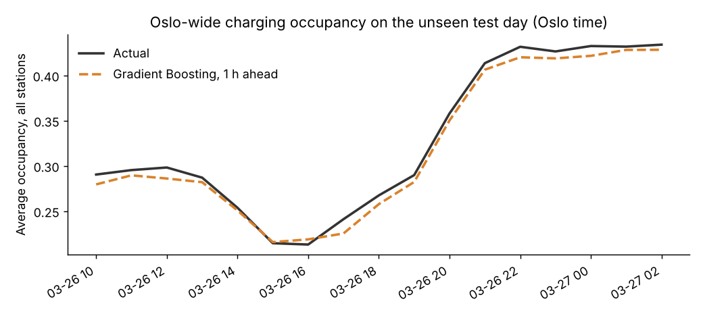
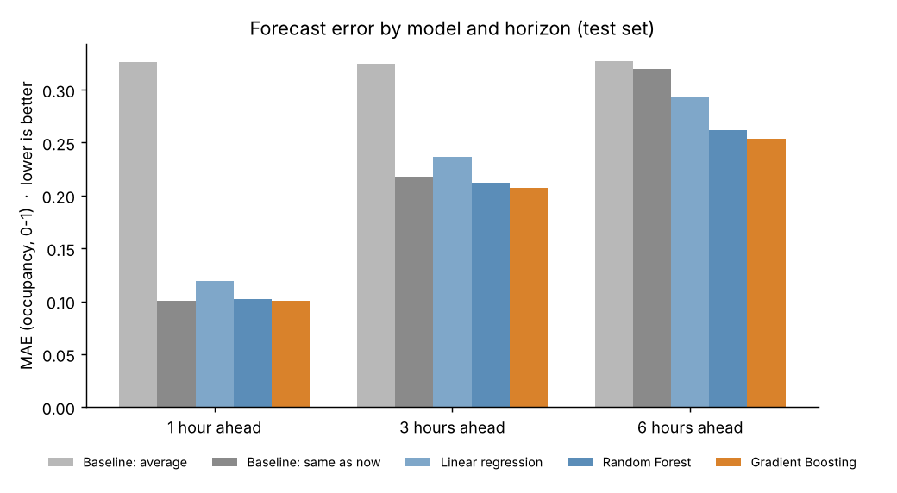
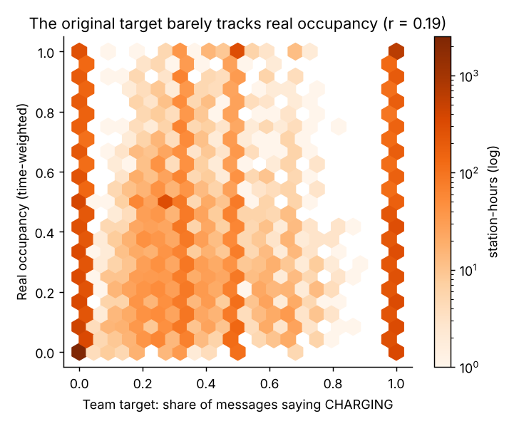
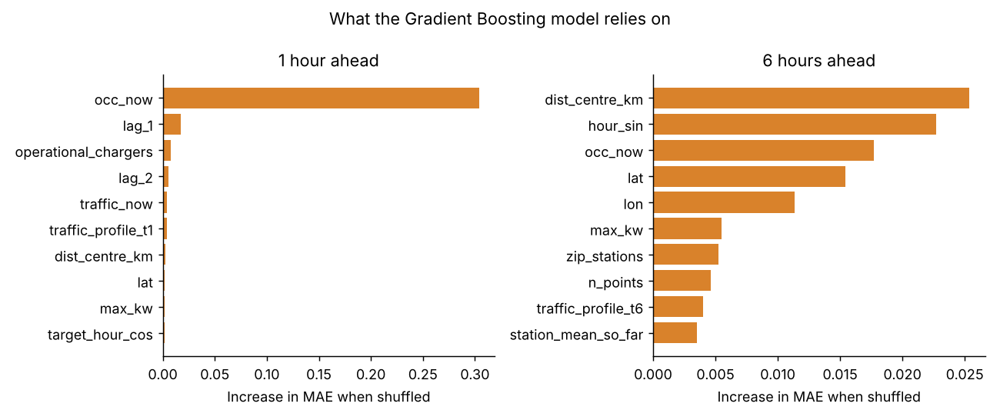
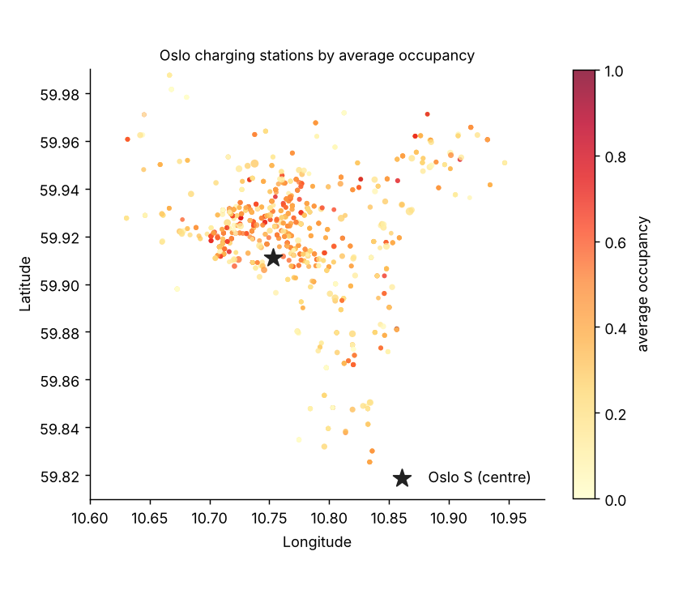
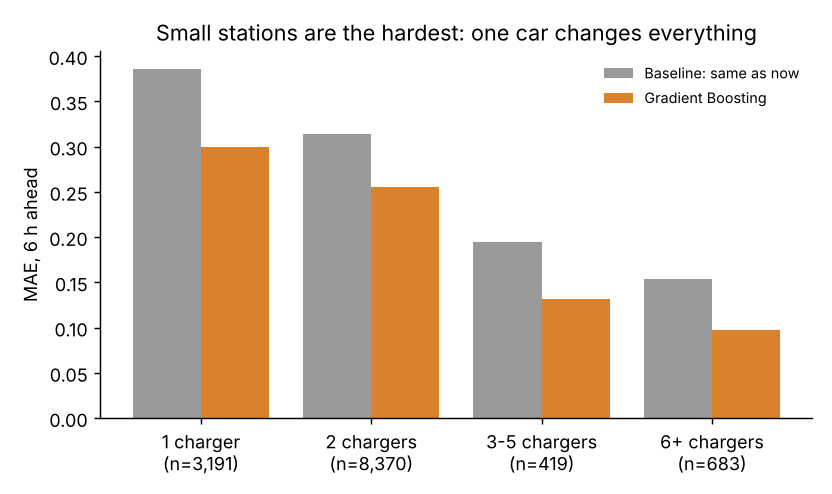
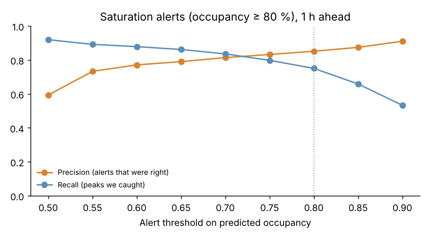

# Forecasting EV charging demand in Oslo


 

How busy will each of Oslo's public EV charging stations be **1, 3 and 6 hours from now**? This repo answers that with real-time charger status data (NOBIL), station metadata and hourly road traffic (Statens vegvesen), and turns the forecast into **saturation alerts** for grid operators.

> **Origin.** This started as a 6-person university project (*Proyecto III*, BSc Data Science, UPV, Feb–May 2026, project DS-PRO-III.16 "EVINY-PREDICTING"). This repository is **my own rebuild of it**. I ported the team's final R model to Python and reproduced its reported results. Then I found and fixed the weak points of the original design: the target variable, data gaps and evaluation. Timeline, my role in the team and the problems we hit: [`docs/project_history.md`](docs/project_history.md).



## Results

Test set: the last 17 hours of data, never seen in training (26 March 2026, 09:00 → 01:00 Oslo time), 12,000–18,000 station-hours per horizon.

| | 1 h ahead | 3 h ahead | 6 h ahead |
|---|---|---|---|
| Baseline "same as now" (MAE) | 0.101 | 0.218 | 0.320 |
| **Gradient Boosting (MAE)** | **0.101** | **0.207** | **0.254** |
| Gradient Boosting (R²) | **0.79** | 0.44 | 0.26 |

*MAE: average error in occupancy, from 0 (all chargers free) to 1 (all busy).*

- **1 h ahead, the present is the best predictor.** The model matches the naive baseline on MAE but cuts big misses (RMSE −17 %, R² 0.70 → 0.79).
- **6 h ahead, ML clearly wins:** 21 % less error than the baseline, because the model learns *where* the station is and *what time* it will be.
- **Saturation alerts** (station ≥ 80 % busy, 1 h ahead): **85 % precision, 75 % recall**. The threshold is a dial between the two.
- **Oslo charges at night.** Occupancy peaks at 22:00–02:00 and is lowest during the morning commute, the opposite of road traffic.



## From the team project to this version

**Step 1: reproduce.** [`src/replicate_team.py`](src/replicate_team.py) is a line-by-line Python port of the team's final R notebook, run on the same raw data:

| | Team final report (May 2026) | My Python reproduction |
|---|---|---|
| Random Forest, t+1: MAE / R² | 0.19 / 0.28 | 0.20 / 0.29 |
| Random Forest, t+3: MAE / R² | 0.17 / 0.17 | 0.18 / 0.15 |
| Random Forest, t+6: MAE / R² | 0.14 / 0.24 | 0.17 / 0.14 |

**Step 2: find what limited it.**



1. **The target wasn't occupancy.** It was the share of status *messages* saying CHARGING. A charger that starts charging sends one message and then stays silent. So about **3 in 4 station-hours had no data**, and where both exist the proxy correlates only **r = 0.19** with real occupancy.
2. **Horizons weren't comparable.** Longer horizons were tested on fewer, busier stations (592 → 204 → 107). That's why the original error *fell* from 1 h to 6 h.
3. **Gaps.** The data collector was offline for 31 hours, and lags could jump across that hole.

**Step 3: fix it.** Replay every charger's state on a 5-minute grid to measure **real, time-weighted occupancy** for every station-hour (68,502 rows for the 1-hour model instead of 5,489). Never carry states, lags or targets across the outage. Evaluate every horizon on all stations, with two naive baselines to beat.

| R² (higher is better) | 1 h | 3 h | 6 h |
|---|---|---|---|
| Team approach (reproduced) | 0.29 | 0.15 | 0.14 |
| **This version** | **0.79** | **0.44** | **0.26** |

*The two use different targets, so R² is the fairer comparison. MAE depends on how spread out each target is.*

## What the model learns



At 1 hour, "how full is it now" dominates (inertia). At 6 hours the model relies on **location** (distance to the centre), **time of day** and station size. Traffic helps only a little once those are known.

| | |
|---|---|
|  |  |

Small stations (1–2 chargers) are the hardest: one car flips them between 0 % and 100 %.




## Data

| Source | What | Size |
|---|---|---|
| [NOBIL](https://info.nobil.no/api) real-time API | Every charger status change, 22–27 March 2026, collected by the team's ingestion service ([cofrian/nobil_data](https://github.com/cofrian/nobil_data)) | 107,127 events · 1,266 stations · 3,144 chargers |
| NOBIL static export | Location, number of points, power (kW), AC/DC, opening hours, parking fee | 4,099 connectors |
| [Statens vegvesen](https://trafikkdata.atlas.vegvesen.no) traffic API (GraphQL) | Hourly vehicle counts for all of March 2026 | 141 sensors (134 with ≥ 90 % coverage) |

## Repository structure

```
├── src/
│   ├── oslo_ev/occupancy.py   # core logic: replay charger states, hourly occupancy, gap-safe shifts
│   ├── build_dataset.py       # raw data → data/processed/station_hour.csv.gz
│   ├── train.py               # baselines, linear, Random Forest, Gradient Boosting × 3 horizons
│   ├── replicate_team.py      # the original team model, ported from R
│   └── analysis.py            # comparisons, map, error analysis
├── tests/                     # unit tests for the occupancy logic (run in CI)
├── notebooks/
│   ├── 01_original_team_eda.ipynb   # exploratory analysis from the team project (Spanish)
│   └── 02_walkthrough.ipynb         # the whole story, step by step
├── reports/                   # metrics, predictions, figures, interactive station map
└── docs/project_history.md    # timeline, my role, problems and how they were solved
```

## Run it

```bash
pip install -r requirements.txt
make all     # build dataset (~30 s), train (~2 min), reproduce team model, analysis
make test
```

CI re-runs the tests and the whole pipeline from the raw data on every push.

## Limitations and next steps

- **Short window:** about 3 days of data, and the test covers one weekday. Weekly patterns aren't learned. A collector running for months would fix this.
- **Occupancy ≠ energy:** a car can stay plugged in after it finishes charging. Session data would give demand in kWh.
- **Traffic is city-wide:** linking each station to its nearest sensor might make traffic more useful.
- **Point forecasts only:** prediction intervals (e.g. quantile gradient boosting) would make alerts easier to act on.

## Credits

Original team (UPV, 2026): Antonio Alberola, Alejandro de las Nieves, Lucía Fito, Nicolás Jiménez, Miguel Jordán, Rubén Luzón.
Data: NOBIL (Enova), Statens vegvesen (Norwegian Public Roads Administration).

---
**Alejandro de las Nieves Duro** · BSc Data Science, Universitat Politècnica de València · [GitHub](https://github.com/alejandrodelas)
