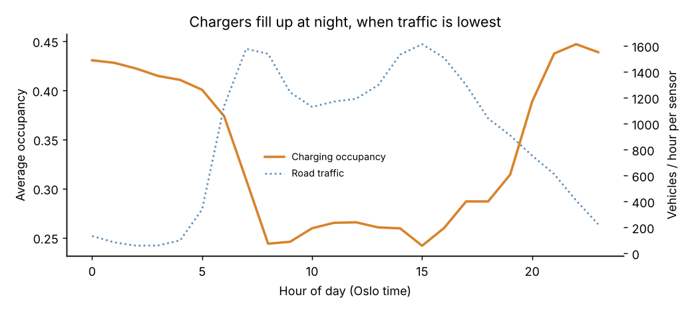

# How busy will Oslo's EV chargers be in a few hours?


Norway has the highest share of electric cars in the world (96 % of new cars sold in 2025 were electric), which makes Oslo a good place to study charging demand.

## What it predicts and why it's useful

For every public charging station in Oslo, the model predicts what share of its chargers will be in use 1, 3 and 6 hours from now, from 0 % (all free) to 100 % (all busy). It uses the live charger status feed from NOBIL, the station register and hourly road traffic counts from Statens vegvesen.

A charging station doesn't store energy, it draws it from the grid the moment a car plugs in. So the point isn't to have energy ready, it's to know the busy hours in advance:

- Peaks cost money. In Norway, grid fees depend largely on peak power, so an operator who sees a busy hour coming can cap or spread the charging.
- Electricity is bought ahead of time. Suppliers buy power on the day-ahead market, and a better demand forecast means better purchases.
- Drivers can be sent to stations that will still have a free charger.
- Stations that fill up again and again show where more chargers are needed.


## Where this comes from

It started as our Proyecto III at UPV (spring 2026), a team project with six of us. With the work split six ways, my part was the data side: cleaning the NOBIL station register, joining it with the real-time events, the exploratory analysis and the [interactive station map](https://github.com/alejandrodelas/Interactive-EV-Charging-Demand-Analysis-Oslo). Teammates built the data collector and the final models in R.

NOBIL's live feed only keeps about two days of charger status, so there was no history to train on. We had to build our own by collecting the feed around the clock on a university virtual machine. That changed the project: with days of data instead of years, we moved from forecasting months ahead to hours ahead. The machine also stopped several times, the longest over the Easter break, when nobody was at the university to restart it, which is why only about three days are usable.

After the course I redid the entire project on my own in Python, from the raw data to the final models, and improved it. Going back over the team results, something didn't add up: our error got smaller the further ahead we predicted, which shouldn't happen. Looking into it, I found two reasons.

1. Our target was the share of status messages saying "charging" in each hour. A charger sends one message when it starts and then goes quiet, so about 3 in 4 station-hours had no data at all. Where there was data, it correlated only 0.19 with how busy the station really was.
2. The 3 h and 6 h models were tested on fewer, busier stations than the 1 h model, so the scores weren't comparable.

So I changed the target. I replay every charger's state on a 5-minute grid and measure how much of each hour it was actually in use. That gives an occupancy value for every station and every hour. I also had to handle a 31-hour gap when the collector was down, so that no lag or target jumps across it.

Before changing anything, I ported the team's R model to Python and checked that it gives roughly the same numbers as our final report, so the comparison is fair.

## Results

Tested on the last 17 hours of data, which the models never saw during training.

| Error (MAE) | 1 h | 3 h | 6 h |
|---|---|---|---|
| Baseline: "same as now" | 0.101 | 0.218 | 0.320 |
| Gradient boosting | 0.101 | 0.207 | 0.254 |

One hour ahead, "same as now" is very hard to beat and the model only matches it, although it makes fewer big mistakes. Six hours ahead it's clearly better, with about 21 % less error, because it learns where the station is and what time of day it will be.

As an alert ("this station will be at least 80 % full in an hour"), 85 % of the alerts were right and it caught 75 % of the real peaks.

What surprised me most was that Oslo's chargers fill up at night, between 22:00 and 02:00, the opposite of road traffic. People charge close to home.



## Limitations

- There are only about three days of usable data, so the model can't learn weekly patterns. A collector running for a few months would fix the biggest weakness.
- Occupancy isn't energy. A car can stay plugged in after it's full. Session data in kWh would be the real demand.
- Traffic is a city-wide signal. Matching each station to its nearest traffic sensor might make it more useful.

## What I took from it

- Data access can change a project completely. The data you planned on may turn out incomplete, different or without a reliable source, and the questions you can answer change with it.
- Relying on outside infrastructure is a double-edged sword: it gives you resources you couldn't have alone, but parts of the project end up outside your control.

## Running it

```bash
pip install -r requirements.txt
make all    # builds the dataset, trains the models, reproduces the team model (~3 min)
make test
```

GitHub Actions runs the tests and rebuilds everything from the raw data on every push.

More detail (the team model reproduction, what the model relies on, error by station size, data sources and repo layout) is in [docs/details.md](docs/details.md). The project timeline and who did what in the team are in [docs/project_history.md](docs/project_history.md).

## Credits

Team (UPV, 2026): Antonio Alberola, Alejandro de las Nieves, Lucía Fito, Nicolás Jiménez, Miguel Jordán and Rubén Luzón. Real-time data collected with the team's [ingestion service](https://github.com/cofrian/nobil_data). Data from NOBIL (Enova) and Statens vegvesen.
